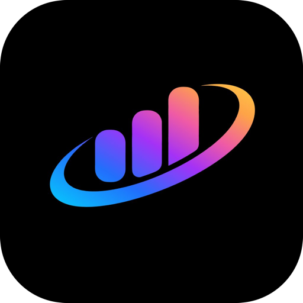
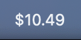
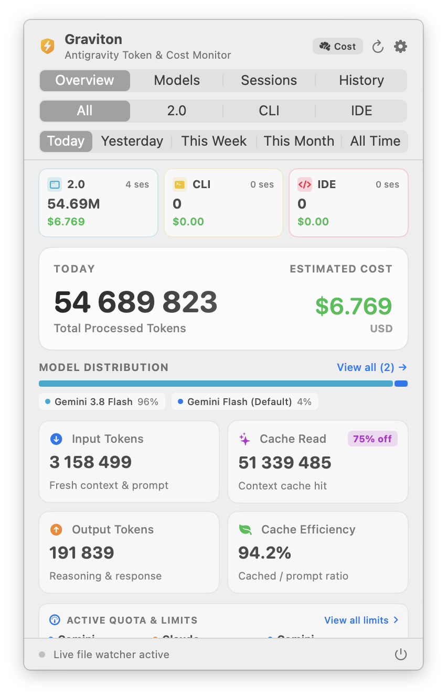
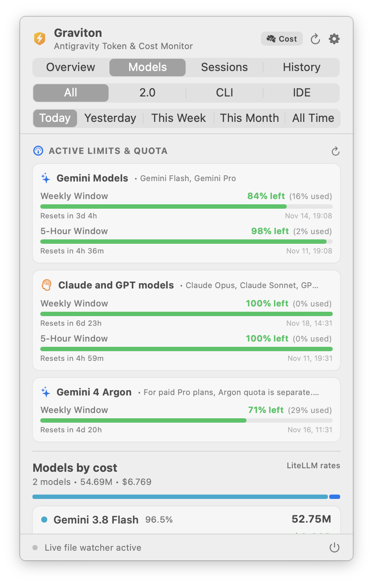
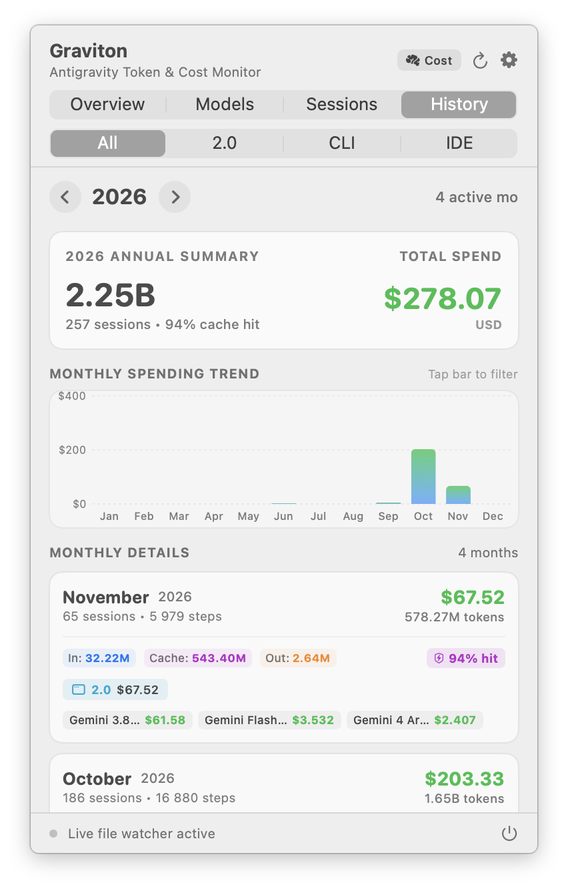
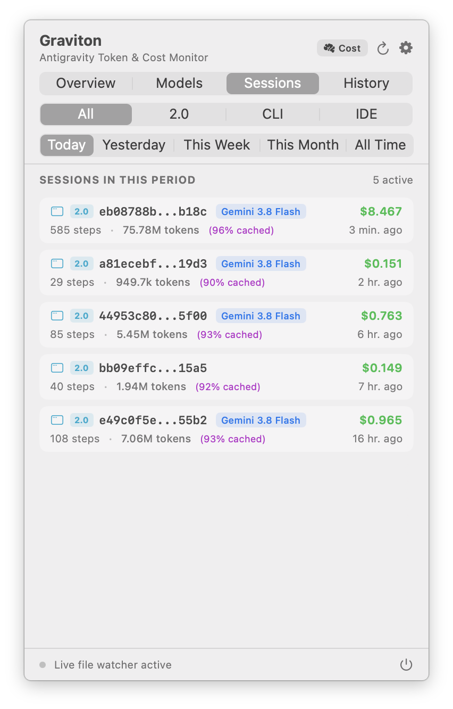
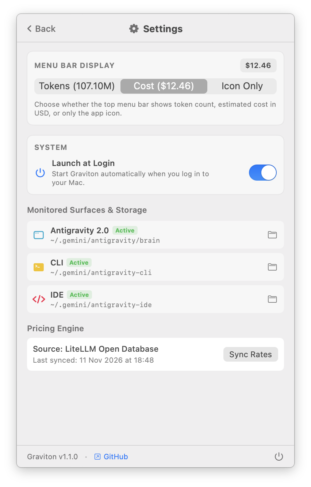

<p align="center">
  
</p>

<h1 align="center">Graviton: Antigravity Token Tracker ⚡️</h1>

<p align="center">
  <a href="https://apple.com"></a>
  <a href="https://swift.org"></a>
  <a href="https://opensource.org/licenses/Apache-2.0"></a>
</p>

**Graviton** is a lightweight, native macOS menu bar application designed to monitor token usage, prompt caching efficiency, real-time expenses, and rate limit quotas across the entire **Google Antigravity** ecosystem:

1. 🖥️ **Antigravity 2.0 (Desktop)**
2. 💻 **Antigravity CLI (`agy`)**
3. 📝 **Antigravity IDE (VS Code Extension & Language Server)**

Built entirely with **SwiftUI** and **AppKit** with a modern Liquid Glass aesthetic, it lives quietly in your menu bar (`LSUIElement`, no Dock icon clutter) and updates automatically in the background.

<p align="center">
  
</p>

---

## 📸 Screenshots

| Overview (Tokens & Cost) | Models Analytics & Quotas |
| :---: | :---: |
|  |  |
| **Annual & Monthly History** | **Sessions Log** |
|  |  |
| **Settings & Preferences** | |
|  | |

---

## ✨ Features

### 🌐 Multi-Surface Unified Tracking
- **Unified Overview (All Surfaces)**: Global metrics with interactive breakdown cards summarizing each environment at a glance.
- **Antigravity 2.0 (Desktop)**: Monitors session trajectories from `~/.gemini/antigravity/brain/**/transcript.jsonl`.
- **Antigravity CLI (`agy`)**: Scans console sessions and trajectory databases from `~/.gemini/antigravity-cli`.
- **Antigravity IDE**: Parses IDE extensions and workspace conversations from `~/.gemini/antigravity-ide`.

### 🚀 System & Startup Integration
- **Launch at Login**: Native macOS 14+ background startup integration via `SMAppService.mainApp`. Enable or disable auto-start directly in Settings.

### ⏱️ Flexible Time Horizons & Historical Analytics
- **Today**, **Yesterday**, **This Week**, **This Month**, **All Time**
- 📅 **Annual & Monthly History**: Dedicated **History** tab featuring an annual year switcher (`< 2026 >`), annual hero summary, interactive monthly spending bar charts (Swift Charts), and granular month-by-month token and model breakdown cards.
- 💾 **Persistent Aggregation**: Saves monthly aggregates locally (`~/Library/Application Support/Graviton/monthly_history.json`) for instant zero-latency loads and permanent preservation even if old session files are later purged.

### 📊 Granular Token & Cache Accounting
- 📥 **Input Tokens**: Fresh context and user prompts.
- ⚡️ **Cache Read Tokens**: Cached context (Prompt Caching) taking advantage of standard ~75–80% cost savings.
- 📤 **Output Tokens**: Model responses including reasoning / thinking tokens.
- 🎯 **Cache Efficiency**: Real-time Cache Hit Ratio (%) to evaluate context optimization.

### 💳 Real-Time Cost Estimation ($ USD)
- **Dynamic Pricing Engine**: Automatically downloads and caches the latest model pricing from the open [LiteLLM catalog](https://github.com/BerriAI/litellm) (`model_prices_and_context_window.json`).
- **Comprehensive Offline Fallbacks**: Built-in pricing tables covering the latest **Gemini 4 / 3.8** family (Flash, Pro, etc.), **Claude 5.5 / 3.7**, and other major models.

### ⏱️ Live Quotas & Limits Monitoring
- **Real-time Quota Fetching**: Queries `agy --print /usage --output-format json` asynchronously with safe fallback parsing.
- **Visual Limit Gauges**: Tracks remaining quota fractions across rolling windows (e.g., Weekly limits, 5-hour rolling windows).
- **Reset Timestamps & Countdowns**: Displays exact reset dates and formatted countdowns.
- **Resilient Local Caching**: Persists last-known quota state in `UserDefaults` so the UI remains instantaneous on launch.

### 🤖 Models Analytics & Interactive Filtering
- 📊 **Model Distribution Bar**: Proportional color-coded indicator (similar to GitHub's language bar) with interactive chips.
- 🔍 **Interactive Filtering**: Click any model chip or card to instantly filter recent sessions to that specific model; clear filters with a single click.
- 📑 **Sessions / Models Toggle**: Effortlessly switch between chronological conversation history and per-model consumption summaries.

### ⚡️ Dual-Layer High-Performance Parsing
- **Streaming JSONL Parser**: Reads desktop planner trajectories incrementally without memory spikes.
- **Zero-Dependency SQLite & Protobuf Decoder**: Inspects CLI and IDE SQLite databases and directly decodes wire-format Google Protobuf blobs (`gen_metadata`) without external C++ libraries.
- **Filesystem Observers (FSEvents)**: Instantly invalidates and updates caches when conversation files change, using file modification times (`mtime`) to avoid redundant re-parsing.

### ⚙️ Menu Bar Customization & Settings
- **Status Bar Display Options**: Show estimated Cost (`$0.24`), Token count (`125k`), combined, or Icon only.
- **Path Health Indicators**: Live status indicators for all monitored directories with direct "Reveal in Finder" actions.
- **Manual Pricing Sync**: One-click update for LiteLLM tariff rates.

---

## 🛠️ Build & Installation

### Requirements
- macOS 14.0 (Sonoma) or newer (Apple Silicon & Intel).
- Xcode 15+ or Command Line Tools (`swift`).

### 1. One-Command Build & Install (Recommended)
Clone the repository, build the production `.app` bundle, install it directly into `/Applications`, and launch it:
```bash
git clone https://github.com/rsimenok/graviton.git
cd graviton
./scripts/build_app.sh --install
```

### 2. Standalone DMG Installer
To build release packages (`.dmg`, `.zip`, `.app`):
```bash
./scripts/build_app.sh
```
Output artifacts are saved in `build/`:
- `build/Graviton.dmg` — Drag & drop installer into `/Applications`.
- `build/Graviton.app` — Standalone application bundle.

> **Note on Launch at Login**: To enable macOS system background startup, Graviton must be running from `/Applications`.

### 3. Run in Development Mode
To run directly from the command line during development:
```bash
swift run
```
*(In development mode outside an application bundle, background Launch at Login registration is safely disabled).*

### 4. Run Test Suite
```bash
swift test
```

---

## 📂 Project Architecture

```text
Sources/Graviton/
├── GravitonApp.swift                  # App entry point (@main) with MenuBarExtra (.window)
├── Models/
│   ├── AppSurface.swift               # Surface definitions (.all, .desktop, .cli, .ide)
│   ├── TokenStep.swift                # Individual step metrics & SessionSummary
│   ├── TimePeriod.swift               # Date-range filtering logic
│   ├── ModelPricing.swift             # Model pricing rules & currency calculations
│   ├── ModelQuota.swift               # Quota groups, buckets, and reset timestamps
│   ├── ModelUsage.swift               # Aggregated per-model statistics & color palette
│   └── MonthlyHistory.swift           # Monthly token & cost records for multi-year tracking
├── Services/
│   ├── LaunchAtLoginManager.swift     # macOS 14+ SMAppService login item controller
│   ├── HistoryStore.swift             # Local JSON persistence & migration for annual history
│   ├── UnifiedScanner.swift           # Central coordinator aggregating all surfaces
│   ├── TranscriptScanner.swift        # Streaming parser for desktop transcript.jsonl
│   ├── SQLiteConversationScanner.swift# SQLite + wire-format Protobuf decoder for CLI & IDE
│   ├── QuotaService.swift             # Live /usage quota discovery, parsing, and caching
│   ├── PricingService.swift           # LiteLLM catalog sync + built-in fallback tariffs
│   └── FolderWatcher.swift            # FSEvents & DispatchSource multi-directory observer
├── ViewModels/
│   └── TrackerViewModel.swift         # Observable coordinator managing state & filtering
└── Views/
    ├── StatusItemLabel.swift          # Menu bar icon & dynamic label formatting
    ├── DashboardView.swift            # Main popover UI with period & surface tabs
    ├── HeroStatsCard.swift            # Primary summary card & 2x2 metric grid
    ├── ModelUsageRowView.swift        # Model cards & proportional distribution bar
    ├── SessionRowView.swift           # Session list item with colored surface badges
    ├── HistoryView.swift              # Annual history view with Swift Charts bar charts
    ├── SettingsSheet.swift            # Preferences sheet, directory status & sync
    └── FocusRingCleaner.swift         # AppKit utility removing default macOS button rings
```

---

## 🤝 Contributing

Contributions, issue reports, and feature suggestions are welcome!
Feel free to open an issue or submit a Pull Request on [GitHub](https://github.com/rsimenok/graviton).

---

## 📄 License

This project is licensed under the [Apache 2.0 License](LICENSE). See the [NOTICE](NOTICE) file for attribution details.
